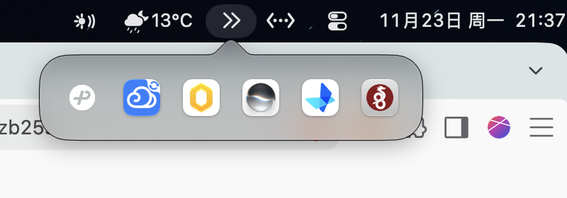
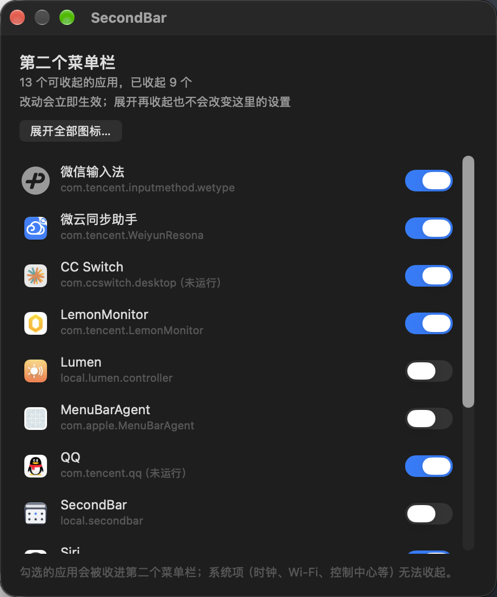

# SecondBar

[](https://github.com/cn-vhql/secondbar/releases/latest)
[](LICENSE)


A second menu bar for macOS 27, for the icons you rarely need but cannot bear to
give up.

macOS 27 rebuilt the menu bar as a single window. The old trick of dragging a long
separator to push icons off the edge stopped working, and the system's own overflow
just folds whatever it feels like into a `»` button — no rules, no choices. SecondBar
gives that job back to you: you decide which apps go into a second bar, and one click
brings them back.



## What it does

**Fold the icons you rarely use.** Pick the apps in a manager window, one switch per
app. Their menu bar icons leave the bar immediately and stay out of the way.

**One `»` in the menu bar.** Click it and a popover shows the folded icons as a small
grid. Click any of them and that app's own menu opens right there — you are not
reopening the app, you get its real menu, exactly as if you had clicked the icon in
the bar.

**Nothing is a screenshot.** The icons are genuinely hidden by the system's own
assessment mode, and the popover shows live icons read through the Accessibility API.
Every folded app keeps working while folded; it just does not take up room.

**Changes take effect at once.** Flip a switch and the menu bar redraws. Rows keep
their place in the list, so the switch you just clicked does not jump away from the
pointer.

**It remembers.** Which apps are folded is stored by bundle identifier, so it
survives relaunches, reboots, and apps that were not running at the time.

**Keep one permanently instead.** ⌥-click an icon inside the popover to put that app
back in the menu bar for good, without opening the manager.

**Launch at login**, from the right-click menu. Uses `SMAppService` when the system
accepts it and falls back to a LaunchAgent otherwise, so it works for a locally built,
self-signed app.

**It tells you what it did.** Everything is logged to `~/Library/Logs/SecondBar.log`,
including why an icon could not be pressed.



## Using it

| Action | Result |
| --- | --- |
| Click `»` | Open the second bar; click again, or click anywhere else, to close it |
| Click an icon in the second bar | Open that app's own menu |
| ⌥-click an icon in the second bar | Keep that app in the menu bar permanently |
| ⌥-click `»` | Open the manager window |
| Right-click `»` | Menu: expand/collapse all, manage apps, launch at login, permissions, quit |

## Requirements

- macOS 27 (Golden Gate) or later. This app exists because of a 27-specific change;
  on earlier versions the menu bar still works the old way and there are better tools.
- Accessibility permission, requested on first launch and needed to read and press
  other apps' menu bar icons. Granting it does not require a relaunch.
- The app must live in `/Applications`. macOS hides the icons of an app running from
  elsewhere, including its own.

## Install

[Download the latest release](https://github.com/cn-vhql/secondbar/releases/latest),
unzip, and drag `SecondBar.app` into `/Applications`.

The first launch will be blocked with *"Apple could not verify SecondBar is free of
malware"*. The release is signed ad-hoc, not notarised — notarisation needs a paid
Apple developer account. Allow it once in **System Settings → Privacy & Security →
Open Anyway**, or clear the quarantine flag yourself:

```sh
xattr -dr com.apple.quarantine /Applications/SecondBar.app
```

Then grant Accessibility when asked. Releases are built by GitHub Actions on a
macOS 27 runner, so you can check what you are installing against the workflow in
`.github/workflows/release.yml`.

## Build from source

No Xcode project, no Apple developer account.

```sh
./make-identity.sh   # once: a stable self-signed identity
./build.sh           # -> build/SecondBar.app
./install.sh         # -> /Applications/SecondBar.app, then launches it
```

`make-identity.sh` is not optional in practice. macOS remembers the Accessibility
grant by signing identity, and an ad-hoc signature has no identity, so every rebuild
of an ad-hoc app looks like a brand-new app and has to be re-authorised by hand. A
stable self-signed identity avoids that.

## If something goes wrong

**Clicking an icon does not open its menu.** Some apps do not respond to the
Accessibility press action at all — measured on macOS 27: WeChat, QQ, CC Switch and
the weather extra report success and open nothing, even when the icon is fully
visible in the bar and nothing is folded. Synthetic mouse events cannot reach another
app's status item either (they move the pointer but open no menu), so after about a
second SecondBar brings that app to the front instead. This is the app's limitation,
not a setting.

**The input method icon shows the wrong glyph.** The input menu item is owned by the
system component `TextInputMenuAgent`, not by the input method itself, so SecondBar
reads the current input source through Carbon TIS for both its glyph and its name.
Switch input method and the folded icon updates the next time the second bar is
redrawn.

**Microphone and camera indicators disappear.** Assessment mode, the system feature
that does the hiding, suppresses those indicators while it is active. Hiding is
released when SecondBar quits.

**The second bar cannot hold system items.** Clock, Wi-Fi, battery and Control Center
are not third-party items; macOS does not let anything fold them.

**Folding is per app, not per icon.** An app's icons fold and unfold together.

## Self-tests

The app can be driven deterministically, which is how it was developed — a
screenshot of an auto-hiding menu bar proves very little:

```sh
SecondBar --dump-ui /tmp/ui.png      # render the manager window offscreen
SecondBar --show-ui                  # show it, printing its screen rect
SecondBar --probe-press <bundle>     # is an item pressable, and does a menu open
```

And for end-to-end runs, a file-based command channel:

```sh
SECOND_BAR_DEBUG=1 SECOND_BAR_DEBUG_FILE=/tmp/cmd \
  /Applications/SecondBar.app/Contents/MacOS/SecondBar
```

One command per line in that file: `open:<bundle>`, `toggle:<bundle>`,
`restore:<bundle>`, `collapse`, `expand`, `panel`, `close`, `manager`.

## How it works

The hiding is the interesting part, and it is the reason this app is 27-only. macOS
27 moved the menu bar into a single window and exposes no public API for folding a
third-party item. What it does expose, privately, is assessment mode: a whitelist of
bundle identifiers that are allowed to *keep* their items. SecondBar loads
`MenuBarClientCore` at runtime, builds a whitelist of every bundle except the ones you
folded, and holds it as an assertion. Inverting the whitelist is what produces the
fold.

Reading and pressing the folded icons uses the public Accessibility API: enumerate
`AXExtrasMenuBar`, find items in the bar band, press with `AXPress`. Apps that open a
menu stop answering Accessibility while the menu is up, so a `cannotComplete` error
from the press actually means it worked; that distinction is what makes clicking a
folded icon reliable.

The second bar itself opens from a cached row list so a click is instant; the
Accessibility walk that refreshes it runs in the background and corrects the contents
in place a few milliseconds later. Because an accessory app never becomes active,
`NSPopover`'s own "click outside to dismiss" does not fire for it, so the panel watches
mouse-downs itself and closes on any click outside its frame and outside the `»`.

## Layout

```text
Sources/
  main.swift          entry point and the self-test flags
  AppDelegate.swift   status item, expand/collapse, opening a folded icon
  Sections.swift      which apps are folded (stored by bundle identifier)
  Hiding.swift        wraps the assessment-mode assertion
  Shim.h / Shim.m     dlopen + objc_msgSend, since the framework is private
  AXReader.swift      reading and pressing status items
  InputSource.swift   icon and name of the current input method
  Panel.swift         the popover
  ManageWindow.swift  the manager window
  LoginItem.swift     launch at login
  Log.swift           writes ~/Library/Logs/SecondBar.log
  SampleApps.swift    stand-in rows for --dump-ui
tools/makeicon.swift  draws the app icon
```

Log: `~/Library/Logs/SecondBar.log`.

## License

Apache License 2.0 — see [LICENSE](LICENSE).

SecondBar uses a private framework (`MenuBarClientCore`). That is what makes it work
at all on macOS 27, and it is also what could break in a future macOS release. It is
loaded at runtime and the app degrades to "hiding unavailable" rather than crashing.

[中文说明](README.zh-CN.md)
