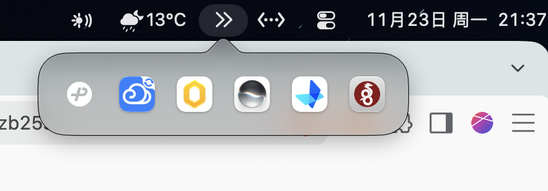
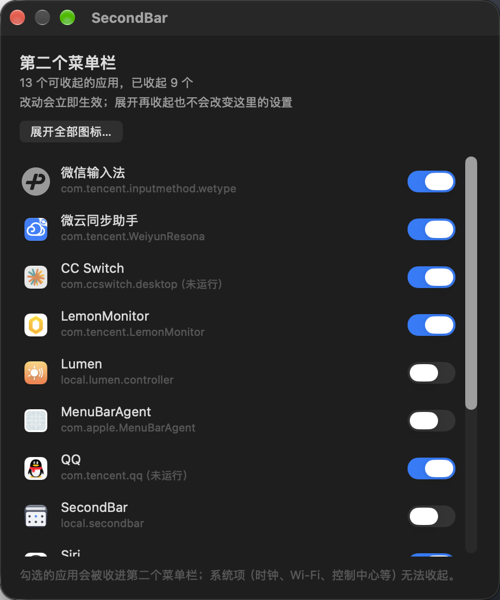

# SecondBar

给 macOS 27 用的「第二个菜单栏」，专门收纳那些很少用到、但又不舍得关掉的图标。

macOS 27 把菜单栏改成了一个整体窗口。过去那种拖一根长分隔符、把图标挤出屏幕边缘的老办法彻底失效；系统自带的溢出控制只会把「装不下的」折进一个 `»` 按钮，既没有规则，也不给你选择权。SecondBar 把这件事实权交回你手上：哪些应用进第二个菜单栏由你决定，点一下就能把它们叫回来。



## 功能

**收走不常用的图标。** 在管理窗口里逐个应用开关。选中的应用立刻从菜单栏消失，不再占位置。

**菜单栏里只留一个 `»`。** 点它，弹出的二级栏把收起的图标排成一个小网格。点其中任何一个，那个应用自己的菜单会就地展开——不是把应用切到前台，而是拿到它真正的菜单，和直接点菜单栏图标完全一样。

**不是截图拼的。** 图标是真的被系统的 assessment mode 隐藏掉了，二级栏里的图标是通过辅助功能接口实时读出来的。收起的应用照常运行，只是不占地方。

**改完立刻生效。** 拨动开关，菜单栏马上重绘。列表里每一行的位置固定不变，所以你刚点过的开关不会从指针底下跳走。

**记得住。** 收起状态按 bundle identifier 保存，重启、注销、应用当时没运行，都不会丢。

**也可以永久放回去。** 在二级栏里 ⌥-单击某个图标，该应用就永久回到菜单栏，不用打开管理窗口。

**开机自启**，在右键菜单里。系统接受时用 `SMAppService`，否则退回 LaunchAgent，所以本地自签名的构建也能用。

**有据可查。** 所有动作都写进 `~/Library/Logs/SecondBar.log`，包括某个图标为什么点不开。



## 用法

| 操作 | 结果 |
| --- | --- |
| 单击 `»` | 打开二级栏；再点一次把图标收回 |
| 单击二级栏里的图标 | 打开该应用自己的菜单 |
| ⌥-单击二级栏里的图标 | 把该应用永久放回菜单栏 |
| ⌥-单击 `»` | 打开管理窗口 |
| 右键 `»` | 菜单：展开/收起全部、管理应用、开机启动、权限、退出 |

## 运行要求

- macOS 27（Golden Gate）或更高。这个应用是为 27 的一处改动而生的；更早的版本菜单栏还是老机制，有更成熟的工具可用。
- 辅助功能权限。首次启动会请求，用于读取和点击其他应用的菜单栏图标。授权后不需要重启应用。
- 应用必须放在 `/Applications`。macOS 会隐藏从其他位置运行的应用的图标，包括它自己的。

## 构建与安装

不需要 Xcode 工程，也不需要 Apple 开发者账号。

```sh
./make-identity.sh   # 只需一次：创建一个稳定的自签名身份
./build.sh           # -> build/SecondBar.app
./install.sh         # -> /Applications/SecondBar.app，然后启动
```

`make-identity.sh` 实际上不能省。macOS 按签名身份记住辅助功能授权，而 ad-hoc 签名没有身份，每次重新构建都会被当成一个全新应用、要重新手动授权。用一个稳定的自签名身份就能避开这件事。

## 遇到问题时

**点图标没反应，菜单没打开。** 有些应用完全不响应辅助功能的 press 动作。在 macOS 27 上实测：微信、QQ、CC Switch 和天气小组件返回「成功」却什么都不打开，即使在完全展开、图标可见的情况下也一样。合成鼠标事件同样点不到别的应用的菜单栏图标（指针会动，菜单不出现），所以大约 1 秒后 SecondBar 会把那个应用切到前台作为兜底。这是应用本身的限制，不是某个开关没开。

**输入法图标显示成别的图形。** 菜单栏里的输入法项属于系统组件 `TextInputMenuAgent`，不属于输入法本身，所以 SecondBar 通过 Carbon TIS 读取当前输入源来取它的图形和名字。切换输入法后，二级栏下次重绘时图标会更新。

**麦克风和摄像头的提示不见了。** 负责隐藏的 assessment mode 是系统功能，它启用期间会屏蔽这两个提示。SecondBar 退出时会解除隐藏。

**系统项收不起来。** 时钟、Wi-Fi、电池、控制中心不是第三方项，macOS 不允许任何东西把它们收起。

**收起是按应用，不是按图标。** 同一个应用的多个图标会一起进出。

## 自测

这个应用可以被确定性地驱动，开发过程就是这样验证的——自动隐藏的菜单栏截图说明不了什么：

```sh
SecondBar --dump-ui /tmp/ui.png      # 离屏渲染管理窗口
SecondBar --show-ui                  # 显示它，并打印屏幕坐标
SecondBar --probe-press <bundle>     # 该图标能否按下，菜单会不会打开
```

端到端测试则用文件命令通道：

```sh
SECOND_BAR_DEBUG=1 SECOND_BAR_DEBUG_FILE=/tmp/cmd \
  /Applications/SecondBar.app/Contents/MacOS/SecondBar
```

文件里每行一条命令：`open:<bundle>`、`toggle:<bundle>`、`restore:<bundle>`、
`collapse`、`expand`、`panel`、`close`、`manager`。

## 实现原理

隐藏是这里最关键的部分，也是这个应用只支持 27 的原因。macOS 27 把菜单栏放进一个整体窗口，没有公开 API 可以折叠第三方图标。它私有的接口是 assessment mode：一份「允许保留图标的 bundle identifier」白名单。SecondBar 在运行时加载 `MenuBarClientCore`，构造一份「除了你收起的所有 bundle」的白名单，并把它作为一个 assertion 持有。把白名单反过来，就产生了「收起」。

读取和点击收起的图标用的是公开的辅助功能接口：枚举 `AXExtrasMenuBar`，找出落在菜单栏带状区域里的项，用 `AXPress` 按下。打开菜单的应用在菜单跟踪期间会停止响应辅助功能，所以按下时返回 `cannotComplete` 反而说明成功了——正是靠区分这两种返回值，「点开收起的图标」才能可靠工作。

## 目录结构

```text
Sources/
  main.swift          入口与自测开关
  AppDelegate.swift   菜单栏项、展开/收起、打开被收起的图标
  Sections.swift      哪些应用被收起（按 bundle identifier 保存）
  Hiding.swift        封装 assessment mode 的 assertion
  Shim.h / Shim.m     dlopen + objc_msgSend，因为框架是私有的
  AXReader.swift      读取与按下菜单栏项
  InputSource.swift   当前输入法的图标与名称
  Panel.swift         二级栏的弹出视图
  ManageWindow.swift  管理窗口
  LoginItem.swift     开机自启
  Log.swift           写 ~/Library/Logs/SecondBar.log
  SampleApps.swift    --dump-ui 用的示例数据
tools/makeicon.swift  绘制应用图标
```

日志：`~/Library/Logs/SecondBar.log`。

## 许可

Apache License 2.0，见 [LICENSE](LICENSE)。

SecondBar 用到了一个私有框架（`MenuBarClientCore`）。它是在 macOS 27 上能工作的唯一原因，也是未来某个 macOS 版本可能失效的原因。它在运行时加载，加载不到时会降级为「隐藏功能不可用」，而不是崩溃。

[English](README.md)
